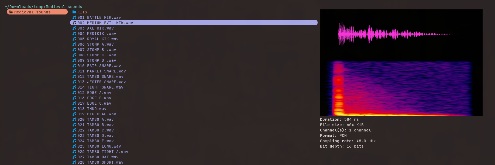

# audio-peek.yazi

A plugin for [yazi](https://github.com/sxyazi/yazi) to preview audio files:
A combined **waveform + spectrogram** image, plus audio file metadata
(duration, format, sample rate, bit depth, bitrate, etc).



## Features

- **Waveform and spectrogram** — the waveform (ffmpeg) is rendered above the
  spectrogram (sox) in a single combined image.
- **Multi-channel** — stereo/multi-channel files get a waveform + spectrogram
  band per channel. The *total* image height stays roughly constant regardless
  of channel count, so channels get proportionally thinner bands instead of the
  image growing taller.
- **Metadata panel** — populated from `mediainfo` (shown only when available).
- **Renders on hover** — the image is generated when you land on a file
  and cached; cached previews show instantly. Moving on cancels the render, so
  opening a folder with hundreds of audio files doesn't kick off hundreds of
  sox/ffmpeg jobs.
- **Graduated sampling** — audio is decoded once to a small 12 kHz wav. Files
  up to 2 minutes are decoded whole; longer ones are sampled (32 × 1s snippets
  up to 10 minutes, 64 × 0.5s beyond), so even hour-long files render in well
  under a second.

## Requirements

| Tool        | Used for                                  |
| ----------- | ----------------------------------------- |
| `sox`       | spectrogram (`soxi` ships with it)        |
| `ffmpeg`    | waveform + combining with the spectrogram |
| `mediainfo` | metadata panel                            |

yazi ≥ 25.x (uses the `job`-based previewer API and `ya.preview_widget`).

## Installation

Install with yazi's package manager:

```sh
ya pkg add empeeby/audio-peek
```

Or copy this directory to `~/.config/yazi/plugins/audio-peek.yazi`.

## Usage

Register it as the previewer for audio in your `yazi.toml`:

```toml
[plugin]
prepend_previewers = [
  { mime = "audio/*", run = "audio-peek" },
]
```

## Configuration

The opinionated bits live as tunables at the top of `main.lua`:

- `WAVEFORM_COLOR` — waveform colour (any ffmpeg colour spec, default `#ff33dd`).
- `SPECTROGRAM_HEIGHT` — combined spectrogram height in px (default `275`).
- `DEBOUNCE` — seconds to wait on an uncached file before rendering (default `0.05`).
- `LEVELS` — how much audio to decode for each duration band (whole file, or
  snippet count × length).
- `DECODE_RATE` — sample rate of the decoded audio; the spectrogram shows
  0 – rate/2 Hz (default `12000`).

## Credits

A fork of [gesellkammer/audio-preview.yazi](https://github.com/gesellkammer/audio-preview.yazi).
Licensed under MIT — see
[LICENSE](./LICENSE).
